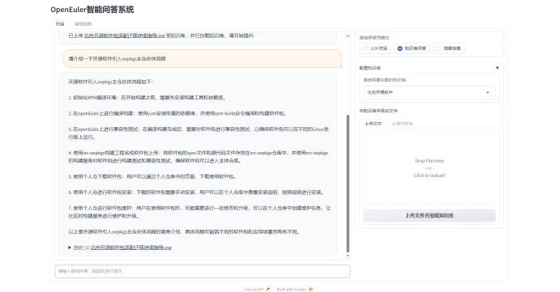
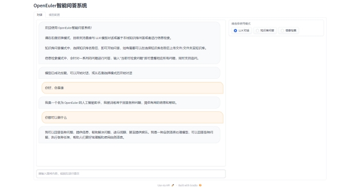
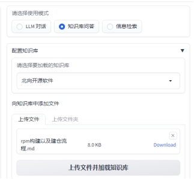
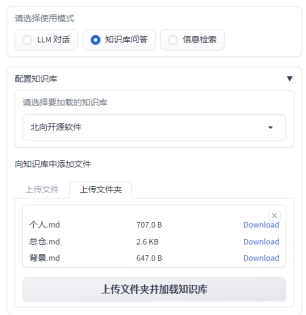
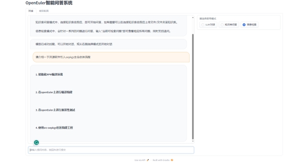
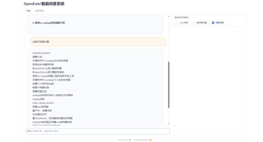

# openEuler Intelligent Q&A System

## System Introduction

It provides a text chatbot service based on the openEuler platform. This service uses the LLM and Chatbot technologies to collect key information during dialogs and answer questions based on the existing knowledge base. For questions that require high accuracy, this service integrates the dialog and information retrieval technologies.

## Principles

ChatGLM-6B is an open bilingual language model (English and Chinese) based on [General Language Model (GLM) framework](https://github.com/THUDM/GLM), with 6.2 billion parameters. With the quantization technique, users can deploy the model locally on consumer-grade graphics cards (only 6 GB of video memory is required at the INT4 quantization level). ChatGLM-6B uses technologies similar to ChatGPT, optimized for Chinese QA and dialogue. The model is trained on about 1T tokens of Chinese and English corpus, supplemented by supervised fine-tuning, feedback bootstrap, and reinforcement learning with human feedback. With only about 6.2 billion parameters, the model is able to generate answers that are in line with human preferences.

A local knowledge-based ChatGLM application implemented using [ChatGLM-6B](https://github.com/THUDM/ChatGLM-6B) + [langchain](https://github.com/hwchase17/langchain) is referred to based on the knowledge base project. The support for the [ClueAI/ChatYuan-large-v2](https://huggingface.co/ClueAI/ChatYuan-large-v2) model in the [clue-ai/ChatYuan](https://github.com/clue-ai/ChatYuan) project is added. Inspired by the [ChatGLM-6B Pull Request](https://github.com/THUDM/ChatGLM-6B/pull/216) created by the [document.ai](https://github.com/GanymedeNil/document.ai) and [AlexZhangji](https://github.com/AlexZhangji) projects of [GanymedeNil](https://github.com/GanymedeNil), a local knowledge Q&A application that is entirely implemented based on open-source models is established.

In this project, [GanymedeNil/text2vec-large-chinese](https://huggingface.co/GanymedeNil/text2vec-large-chinese/tree/main) is used for Embedding by default, and [ChatGLM-6B](https://github.com/THUDM/ChatGLM-6B) is used as the default LLM. Based on the preceding model, this project can implement **offline private deployment** using all **open-source** models.

The following figure shows the implementation principle of this module. The process includes loading files -> reading text -> text segmentation -> text vectorization -> question vectorization -> matching `top k` text vectors that are most similar to the question vector -> adding the matched text as the context and question to the `prompt` -> submitting them to the `LLM` to generate an answer.

! [Implementation principle diagram](img/langchain+chatglm.png)

The information retrieval-based module constructs retrieval pairs to ask questions in professional fields, ensuring that the answers to key questions are accurate, comprehensive, specific, and highly practical.

🚩 This project does not involve fine-tuning or training processes, but fine-tuning or training can be used to optimize the project's performance.

## Hardware Requirements

- Hardware requirements of the ChatGLM-6B model
  
    | **Quantization Level**  | **Minimum GPU Video Memory** (Inference)| **Minimum GPU Video Memory** (Efficient Parameter Fine-Tuning)|
    | -------------- | ------------------------- | --------------------------------- |
    | FP16 (without quantization)| 13 GB                     | 14 GB                             |
    | INT8           | 8 GB                     | 9 GB                             |
    | INT4           | 6 GB                      | 7 GB                              |

- Hardware requirements of the Embedding model

    In this project, the default Embedding model [GanymedeNil/text2vec-large-chinese](https://huggingface.co/GanymedeNil/text2vec-large-chinese/tree/main) occupies about 3 GB of video memory. You can also modify the model to run on the CPU.

## Development and Deployment

### Software Requirements

This project has been tested in the Python 3.8–3.10 and CUDA 11.7 environments. The test has been completed in Windows, macOS of the ARM architecture, and Linux.

### Loading a Model from the Local PC

For details, see [THUDM/ChatGLM-6B# loading a model from the local host](https://github.com/zai-org/ChatGLM-6B/blob/main/README_en.md#load-the-model-locally).

### 1. Setting Up the Environment

For details, see [Installation Guide](docs/INSTALL.md).

### 2. Setting Default Model Parameters

Before performing WebUI or CLI interaction, check whether the model parameter design in [configs/model_config.py](configs/model_config.py) meets the requirements.

### 3. Executing the Script to Experience WebUI or CLI Interaction

> Note: Considering that problems may occur during environment deployment, you are advised to test the command line script first. You are advised to run the WebUI after the command line script test is successful.

Execute the **[cli_demo.py](cli_demo.py)** script to experience **CLI interaction**.
```shell
$ python cli_demo.py
```

Alternatively, execute the **[webui.py](webui.py)** script to experience **Web interaction**.

```shell
$ python webui.py
```

Note: If the model is not downloaded to the local host, check the remaining space of the `$HOME/.cache/huggingface/` folder before the execution. The remaining space must be at least 15 GB.

The following figure shows the execution result.

The Web UI provides the following functions:

1. Before the execution, the system automatically reads the `LLM` and `Embedding` model enumeration and default model settings in `configs/model_config.py` to run the model. If you need to reload the model, select the model again on the `Model Configuration` tab page and click `Reload Model`.
2. You can manually adjust the length of the retained conversation history and the number of knowledge base segments to be matched based on the size of the video memory.
3. The mode selection function is available. You can select the `LLM Dialog`, `Knowledge Base Q&A`, or `Information Retrieval` mode. Streaming dialogs are supported.
4. The `Knowledge Base Configuration` function is added. You can select an existing knowledge base or create a knowledge base, and click **Add** to upload a file or folder to the knowledge base. After selecting a file using the file upload component, click `Upload File and Load Knowledge Base`. The data of the selected file is loaded to the knowledge base, and Q&A is performed based on the updated knowledge base.
5. The `Information Retrieval` function is added to support retrieval and access of built-in questions. For details about how to incrementally build retrieval pairs using Markdown files, see the document.

## User Interaction

#### Page 1 - LLM Dialog

Users can directly interact with the LLM to implement simple Q&A and function inquiries.

 

This page consists of a dialog box and a navigation bar on the right. The dialog box on the left displays some basic information and descriptions of the system. It also contains a dialog box that allows users to enter text in the text box and ask questions to the model. The model performs inference and provides answers in the text box, similar to a chat interface. The navigation bar on the right displays the current mode, which is "LLM Dialog." Users can directly interact with the system assistant, which can answer some basic questions. The text box area mainly includes text input for question asking, and provides answers in a chat-like manner.

####  Page 2 - Knowledge Base Q&A

Users can create a knowledge base. After selecting a knowledge base name, users can start asking questions. If necessary, users can upload files or folders to the knowledge base after selecting the knowledge base name.

 

This page consists of a dialog box and a navigation bar on the right. The dialog box on the left displays some basic information and descriptions of the system. It also contains a dialog box that allows users to enter text in the text box and ask questions to the model. The model performs inference and provides answers in the text box, similar to a chat interface. The navigation bar on the right displays the current mode, which is "Knowledge Base Q&A". Users can create a knowledge base or select an existing one to upload files and ask questions related to the knowledge base. Creating a knowledge base is supported.

Files can be uploaded.

 

Folders can be uploaded.

 

#### Page 3 - Information Retrieval

Q&A is supported for a series of questions. Users can enter "Current Retrievable Questions" to view all related questions and ask follow-up questions.

 

This page consists of a dialog box and a navigation bar on the right. The dialog box on the left displays some basic information and descriptions of the system. It also contains a dialog box that allows users to enter text in the text box and ask questions to the model. The model performs inference and provides answers in the text box, similar to a chat interface. The navigation bar on the right displays the current mode, which is "Information Retrieval". Q&A is supported for a series of questions. Users can enter "Current Retrievable Questions" to view all related questions and ask follow-up questions.

Users can view retrievable questions.

 

### FAQ

For details, see [FAQ](docs/FAQ.md).
